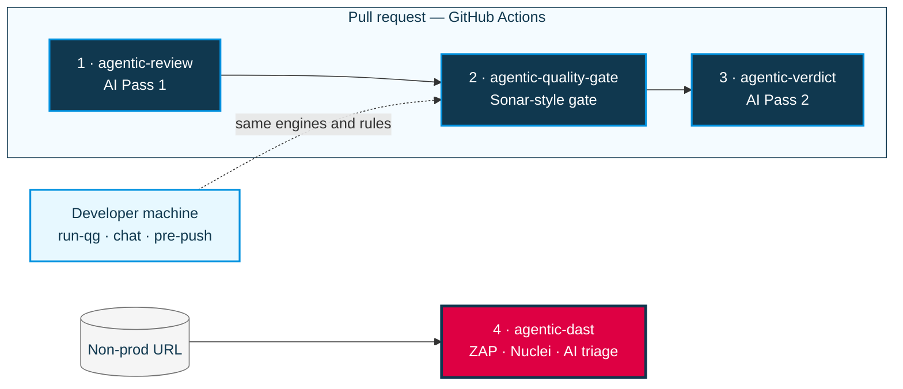

# agentic-dast

Isolated hub for **open-source DAST** in **GitHub Actions only**: ZAP + ProjectDiscovery Nuclei, then AI triage.

Do **not** run scanners on corp laptops (Netskope / TLS interception). Use Actions → **DAST manual (hub)**.

## Part of the Agentic AppSec platform

This repo is one of four hubs that together give Bayer teams agentic SAST and DAST checks: open-source scanners, with findings explained and prioritized by AI. For the problem statement, the full architecture diagram and the end-to-end PR flow, see **[Platform overview in agentic-review](https://github.com/bayer-int/agentic-review#platform-overview)**.



<sub>Highlighted in pink: this repo.</sub>

| # | Hub | Role |
|:-:|:----|:-----|
| 1 | [agentic-review](https://github.com/bayer-int/agentic-review#readme) | AI Pass 1: detects the stack, runs lint / test / build, dependency audit, secret and IaC scans |
| 2 | [agentic-quality-gate](https://github.com/bayer-int/agentic-quality-gate#readme) | Sonar-style gate: security hotspots, secrets, duplication, complexity, coverage. Also runs locally as `run-qg` |
| 3 | [agentic-verdict](https://github.com/bayer-int/agentic-verdict#readme) | AI Pass 2: weighs all evidence, posts the final PR review, approve / request changes, label |
| 4 | **agentic-dast** (this repo) | Runtime scans of a live non-prod URL (OWASP ZAP + Nuclei) with AI triage into a sticky Issue |

---

## Pipeline role

```
PR:     agentic-review → agentic-quality-gate → agentic-verdict   (unchanged)
DAST:   schedule/manual (CI) → agentic-dast → sticky GitHub Issue
```

## What it does

1. ZAP against `target_url` (`baseline` = passive; `deep` = full/active)
2. Nuclei templates (broader tags in `deep`)
3. Deduplicate → `dast-findings.json`
4. AI triage — short summary + collapsed details on a sticky Issue
5. Upload `agentic-dast` artifact

## Scan profiles

| Profile | Behavior | Typical use |
|---------|----------|-------------|
| `baseline` | ZAP baseline + Nuclei | Nightly / quick |
| `deep` | ZAP full-scan + richer Nuclei tags | Manual / weekly deep |
| `api` | Alias of `deep` (OpenAPI import later) | Same as deep |

## How to run (CI)

1. Open https://github.com/pulumamidi-harsha/agentic-dast/actions  
2. **DAST manual (hub)** → Run workflow  
3. `target_url` = Dev HTTPS only (never production)  
4. `scan_profile` = `baseline` or `deep`  
5. Read the sticky Issue (summary short; expand sections for detail)

Required secrets: `AI_API_KEY`, `AI_API_ENDPOINT`.  
Optional: `DAST_AUTH_HEADER_VALUE` for authenticated scans.  
Optional variable: `DAST_TARGET_URL` for scheduled baseline.

## Non-goals

- No local laptop scans  
- No Burp / paid SaaS  
- No PR merge gate  
- No production scanning  
- Does not replace Semgrep SAST in quality-gate
