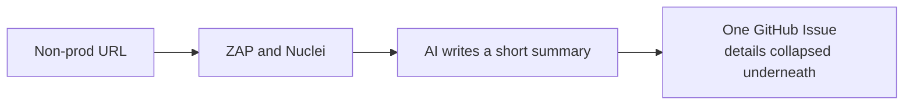

# agentic-dast

Scans a running app for vulnerabilities and files one GitHub Issue. GitHub Actions only. Open-source scanners: OWASP ZAP and Nuclei, then a short AI summary.

One of four hubs, and separate from the pull request. The full picture is the [Agentic AppSec overview](https://github.com/bayer-int/agentic-review#readme).

## What this repo does

It does not run on a laptop, it does not scan production, and it does not block a merge.

## How to run it

1. Open the **DAST manual** workflow in Actions and run it.
2. `target_url` is a dev or test HTTPS URL.
3. `scan_profile` is `baseline` for a quick passive scan, or `deep` for a full active scan.
4. Read the Issue. The summary is short. Expand a section for the detail.

| Profile | What it does |
|:--------|:-------------|
| `baseline` | Passive ZAP plus Nuclei. Good for a nightly run |
| `deep` | Full ZAP scan plus a wider Nuclei set |
| `api` | Same as `deep` today |

Secrets: `AI_API_KEY` and `AI_API_ENDPOINT`. Add `DAST_AUTH_HEADER_VALUE` when the app needs a logged-in session. Set the `DAST_TARGET_URL` variable to run `baseline` on a schedule.
